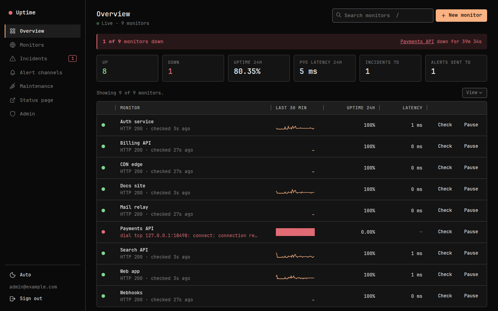
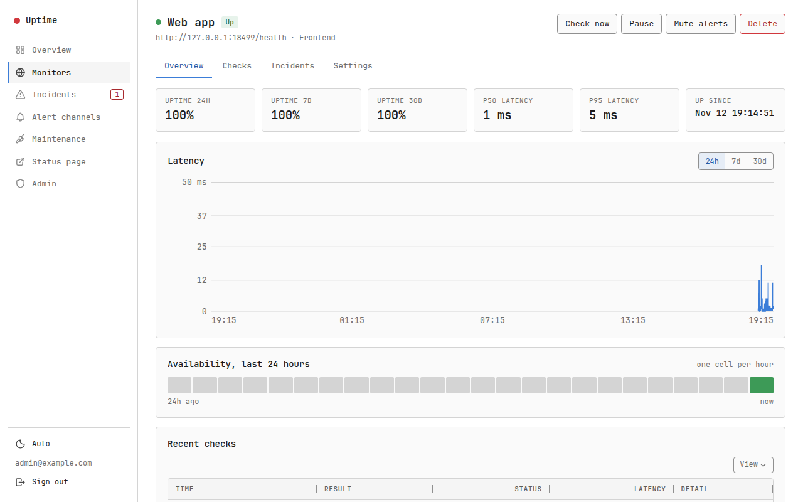
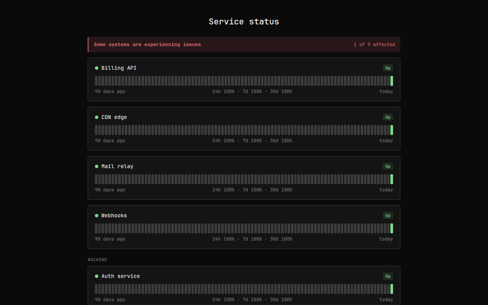
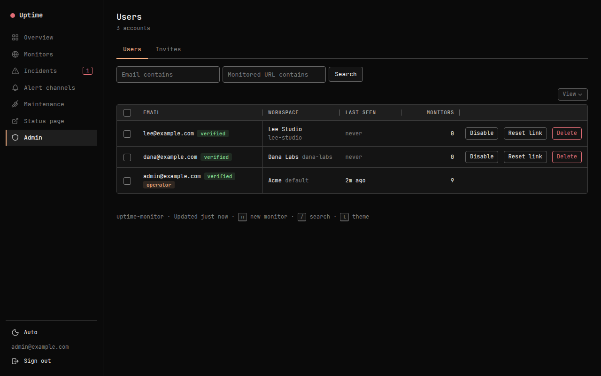

# Uptime monitor

A single-binary uptime monitor written in Go. It checks URLs on a schedule,
records every result in SQLite, opens and closes incidents, alerts over
Telegram, Slack or email when a service goes down or recovers, and serves a
dashboard, an admin UI and a public status page. No runtime dependencies, no
build step for the frontend.

## Features

- Sidebar app shell with light, dark and auto themes, toasts, and keyboard shortcuts (`n` new monitor, `/` search, `t` theme)
- First-run guide, and a slide-over to add a monitor with a "Test URL" probe before saving
- Live updates on every page over Server-Sent Events, no reloads
- Incident acknowledgement and notes; per-monitor alert muting; per-channel enable toggle with last-delivery status
- Public status page with a configurable title and description, and monitors grouped by name
- Maintenance windows for the whole organisation or one group: planned downtime opens no incident, sends no alert, is left out of uptime, and is announced on the status page

- One goroutine per target, each with its own interval and timeout
- Status code and optional body keyword checks
- A target is marked down after N consecutive failures (default 2) and up on
  the first success, so a single blip does not page you
- Incidents with start, end, duration, cause and which channels were alerted
- Alerts are tried 3 times in total, with backoff; every attempt is logged
- Dashboard with heartbeat bars, 24h/7d uptime and live refresh
- Target detail with latency chart (24h/7d/30d), incidents and recent checks
- Targets and alert channels editable in the browser, no restart needed
- Public status page with 90-day history
- Accounts: sign in with email and password, database-backed sessions, rate-limited sign-in
- Several workspaces on one instance, created by invitation or open sign-up, each with its own monitors, alert channels and status page, and per-workspace limits
- JSON API for scripting
- State is restored on restart, so an ongoing incident is not re-alerted

## Screenshots

| | |
|---|---|
|  |  |
|  |  |

## Quick start

```bash
cp config.example.json config.json
# edit targets, then:
go run . -config config.json
```

Open http://localhost:8080. The public status page is at `/s/default`; `/status` redirects to the signed-in user's status page, or for anonymous visitors to the operator's.

With Docker:

```bash
cp config.example.json config.json   # keep it readable (0644): the container reads it as a non-root user
docker compose up -d
docker compose logs uptime | grep 'setup required'   # the setup link
# or: docker compose exec uptime uptime-monitor -setup-link
```

The config is mounted read-only at `/etc/uptime-monitor/config.json` and the
database lives in the `uptime-monitor-data` volume at `/data`. The container
runs as a non-root user with a read-only root filesystem and a health check
on `/healthz` (which assumes the default `listen` of `:8080`). If a reverse
proxy on the same host fronts it, publish the port as `127.0.0.1:8080:8080`
(see the comment in `docker-compose.yml`).

### Accounts

Sign in with email and password. On first run there are no users, and the
server logs a setup link at WARN (`setup required: open …/setup?token=…`).
Open it to create the operator account. If you missed it, run
`uptime-monitor -setup-link` for a fresh link. Only one setup token is valid
at a time: each server start in setup mode, and each `-setup-link`, replaces the previous link. A link expires after 24 hours. Setup adopts workspace 1 and renames
it; the config's `targets` and `notify` are seeded into it afterwards.

- **Passwords** are at least 10 characters and at most 256 bytes, hashed with argon2id.
- **Sessions** are stored in the database. They expire 30 days after sign-in
  or after 7 days idle, and a user has at most 20. "Sign out everywhere" on
  Settings → Security revokes them all. Changing the password keeps only the current
  session. A password reset signs the user out everywhere, then signs in only a browser with no session or the same user's session.
- **Cookies.** The session cookie is `uptime_session`, or `__Host-uptime_session`
  (Secure) when the request is HTTPS or `base_url` is https. A device cookie,
  `uptime_device` (`__Host-uptime_device` under the same rule), lasts 90 days
  and exempts a browser that has signed in before from the per-email slowdown
  below. Its HMAC key is created per process, so a restart invalidates device
  cookies (sessions are in the database and survive a restart).
- **Lost password.** `uptime-monitor -reset-password you@example.com` prints a
  link that works for 1 hour. It refuses unknown and disabled users; re-enable
  a disabled account with `-enable-user` (see Operator panel).
- **Plain HTTP.** With an https `base_url` the session cookie is `__Host-`
  and Secure, so signing in over plain HTTP (for example
  `http://<lan-ip>:8080`) silently fails. Use the https address.
- **Links.** `base_url` is the external URL used in the setup, reset and invite links and in emailed links.
  Without it the links are built from `listen`.

Rate limits are kept in memory, so they reset on restart; run one server
process only. IPv6 clients are grouped by /64 (logs still show the full address).

| What | Limit |
|---|---|
| Sign-in failures | 5 per minute per address; 10 per 15 minutes per email and address |
| Sign-in slowdown | after 20 failures in 15 minutes for one email, at most 1 attempt every 5 seconds. This slows sign-in down but never locks the account |
| Setup attempts | 5 per 15 minutes per address |
| Current-password checks | 5 per 15 minutes per user |
| JSON API | 120 per minute per session |
| Live updates | 5 streams per user |
| Status pages | 120 per minute per address, at most 2 rebuilds at once |
| Password hashing | 4 at once, 64 waiting; a request that can't queue, or waits more than 2 seconds, gets 503 |

A restart invalidates device cookies, so during an attack the per-email
slowdown can then delay the owner's own sign-in. Recover with
`uptime-monitor -reset-password <email>`: its link signs you in without going
through the sign-in limits.

### Settings

The gear item at the bottom of the sidebar opens Settings, with four pages
and a sub-navigation (a list beside the content on wide screens, tabs above it
on narrow ones):

| Page | Path | Contents |
| --- | --- | --- |
| Profile | `/settings/profile` | email, time zone |
| Security | `/settings/security` | password, sign-in methods (Google, GitHub), sign out everywhere |
| Notifications | `/settings/notifications` | alert channels (Telegram, Slack, email), as the Alert channels page was |
| Danger zone | `/settings/danger` | delete account (operators are redirected to Profile) |

`/settings` goes to Profile. The old `GET /account` and `GET /alerts` answer
302 to Security and Notifications. Their POST paths (`/account/...`,
`/alerts`, `/alerts/test`) still work for this release, so a form left open
during an upgrade is not lost, and are removed in 1.7.0.

### Sign-up and invites

`signup` sets who may create an account. `invite` needs an https `base_url` (http is allowed only for localhost or a
loopback address). `closed` does not, and `-invite` links then use the
`listen` address. Each new account gets its own workspace.

| `signup` | `/signup` without an invite | With a valid invite |
|---|---|---|
| `closed` (default) | 404 | works |
| `invite` | explains that sign-up is by invitation | works |
| `open` | anyone may sign up; needs `mail` | works |

`closed` does not switch sign-ups off: invites already issued keep working
until they expire. To stop new accounts, set `limits.max_workspaces` to the
current workspace count, or revoke the unused invitations on the operator
panel's invites page.

`open` needs `mail` and `base_url` (see System email). A new account must verify
its address before it can sign in. Sign-up answers the same whether or not the
address already has an account: an existing owner gets a notice email instead
(at most one per 24 hours). At `limits.max_workspaces`, open sign-up answers
403 for every address.

An invitation bound to an address (`-invite person@example.com`) proves that
address, so the account is verified at once. An unbound invitation (`-invite`
with no email, or the operator panel's "any address") does not: when `mail` is
set, the new account verifies its address by email exactly as in open sign-up,
and until it does it cannot sign in and receives no alert emails from the
server. Without `mail` there is no way to verify, so such accounts are verified
at sign-up as before. Unverified accounts are deleted 48 hours after sign-up by
the hourly prune (operators excepted; D-127). The invitation is used up when the
account is created, so if the invitee mistypes their address or never verifies,
issue a new invitation after the account is deleted.

Create an invitation after setup with `uptime-monitor -invite` (any holder of
the link may sign up) or `uptime-monitor -invite person@example.com` (the
sign-up must use that address). It prints a link that works once and expires
after 7 days. The email, if any, must come last, after any other flags. The
operator panel's invites page lists, creates and revokes invitations too (see
Operator panel).

Sign-ups are limited to 5 per hour per client address, and
`limits.signups_per_hour` across the instance (see below). In open mode every
well-formed sign-up attempt, duplicates included, takes a
`limits.signups_per_hour` slot and is not refunded. In invite mode only a
request with a valid invite spends one.

### Sign in with Google or GitHub

People can sign in, and sign up where `signup` allows it, with a Google or
GitHub account as well as with email and password. It is optional and off by
default: each provider is enabled when you register your own OAuth app and
add its keys to the `oauth` block. With no provider configured, or while a
provider is down, email and password work as before.

**GitHub.** Create an OAuth App under Settings, Developer settings, OAuth Apps.
Set the Homepage URL to your `base_url` and the Authorization callback URL to
`<base_url>/auth/github/callback`. Copy the client ID and generate a client
secret. The server asks for the `user:email` scope.

**Google.** In the Google Cloud console create an OAuth client of type "Web
application". Set the Authorized redirect URI to
`<base_url>/auth/google/callback`. On the consent screen request only the
basic scopes `openid` and `email`, which need no scope verification, and
publish the app to "In production". Without brand verification the consent
screen shows only your domain.

Both providers get `prompt=select_account`, so the account picker is shown.

```json
"oauth": {
  "google": { "client_id": "123-abc.apps.googleusercontent.com", "client_secret": "${GOOGLE_CLIENT_SECRET}" },
  "github": { "client_id": "Iv1.abc123", "client_secret": "${GITHUB_CLIENT_SECRET}" }
}
```

Leave out a provider to keep it off. A provider whose values are both empty
(for example when its variables are unset) is treated as not configured. The
server refuses to start when only one of `client_id` and `client_secret` is
set, when `base_url` is empty or not https (http is allowed only for
localhost or a loopback address), or when `oauth` has a key other than
`google` or `github`.

**Sign-up.** A new person signing up this way follows the `signup` mode:
`open` allows it, `invite` needs a valid invite, and `closed` without an
invite answers "Sign-up on this instance is by invitation." The provider's
verified email is used and the account is marked verified, so `open` mode
needs no verification mail for it. The usual sign-up limits apply. The new
account gets a workspace named "My workspace", so the email never appears in
a status page address. The owner can rename it.

**Linking.** An account is never linked to a provider by email address, so
controlling an address at a provider is not enough to take over an account.
If the provider's email already belongs to an account that is not linked, the
server creates nothing and answers 409, telling the person to sign in with
their password (or use Forgot password) and then connect the provider from
Settings. This does tell a visitor that the address has an account (see
D-129). A signed-in user connects or disconnects Google and GitHub in
Settings → Security, under "Sign-in methods". Each provider can be connected once per
account, and each provider account to one user only. The provider's email may
differ from the account's. Connecting needs a sign-in within the last 10
minutes (an account with a password confirms it instead), and the account's
email gets a notice when a provider is connected or disconnected.
Disconnecting the last way to sign in is refused.

**Accounts without a password.** An account created through a provider has no
password. It cannot sign in with one until the owner sets one under
Settings → Security or uses Forgot password. For these accounts, deleting the
account, connecting and disconnecting a provider ask for a sign-in within the
last 10 minutes instead of the password, by signing in again with a connected
provider. That proves only that the browser holds a live session with that
provider, not that the user just typed a password.

**First password.** When `mail` is set, **Email me a link** on Settings →
Security emails a one-hour link to the account's address, and the password is
chosen on the `/reset` page (worded "Choose a password" while the account has
none). The page then says to check the inbox and offers Send again; if a mail
budget refused the message, it says a link was sent recently instead of
claiming success. The inbox, not a recent provider sign-in, is the proof, so the in-place
form is gone and its POST is refused. The button is limited to 3 links per
hour per user and shares the per-address reset-mail budget. Without `mail` no
link can be sent, so the earlier rule stays: a provider sign-in within the
last 10 minutes, then the password form on the Security page. The link always
goes to the address the account signed up with; the account email cannot be
changed.

Starting and finishing a provider sign-in are limited to 20 per minute per
client address. The sign-in state lives in a cookie for 10 minutes. The
operator panel's users list shows a badge for each provider a user has
connected.

On upgrade the database moves to schema version 3; see Upgrading.

### System email

The optional `mail` section is the SMTP account the server itself uses for
verification, password reset and notice emails. It is separate from the alert
channels in `notify`.

```json
"mail": {"smtp_host": "smtp.example.com", "smtp_port": 587, "username": "up", "password": "${SMTP_PASSWORD}", "from": "up@example.com"}
```

| Key | Default | Meaning |
|---|---|---|
| `smtp_host` | required | SMTP server |
| `smtp_port` | `587` | `465` uses implicit TLS, any other port (such as `587`) STARTTLS |
| `username`, `password` | empty | credentials; never sent over an unencrypted connection |
| `from` | required | sender, a bare address such as `up@example.com` |
| `require_tls` | `true` | refuse to send without TLS |

`mail` needs `base_url`, because the links in the emails are built from it.
`config.example.json` leaves `mail` out because it needs a real SMTP account.
The SMTP host may be a private address, since you chose it.

What it sends:

- **Verification** (`signup: "open"`): a link valid for 24 hours. `/verify/resend` sends a new one. Accounts still unverified 48 hours after sign-up are deleted by the hourly prune (so a verify link resent late may expire together with the account), operators and disabled accounts excepted (D-127). Re-enabling an unverified account older than 48 hours means the next hourly prune deletes it, so send a reset link instead (resetting verifies the address).
- **Forgot password**: `/forgot` sends a reset link valid for 1 hour. It answers the same for every address. Completing a reset also verifies the address. `/reset` and `/verify` links open even while you are signed in; a reset signs in only a browser with no session or the same user's session.
- **Password-change notice**: sent after a reset or a change in Settings → Security.
- **Duplicate sign-up notice**: sent to the existing owner when someone signs up with their address.

Mail budgets (in memory, reset on restart). A message over a budget is dropped
with a WARN `event=mail_dropped`, and no new link is created, so the link
already sent keeps working:

| Budget | Limit |
|---|---|
| Per recipient, all system email | 3 per hour and 10 per day |
| Duplicate sign-up notice | 1 per 24 hours per account |
| `/forgot` and `/verify/resend` | 10 per hour per client address, shared |
| Whole instance per hour (`limits.mail_per_hour`) | `500` by default, at least `1` |
| Whole instance per day (`limits.mail_per_day`) | unlimited (`0`) by default |

The password-change notice counts only against the instance budgets.

Without `mail`, `/forgot` and `/verify/resend` return 404 and sign-in offers no
resend form. Use `uptime-monitor -reset-password <email>` to recover an account.

#### Fallback alert email

With `mail` set, a workspace that has no email alert channel (no SMTP host)
gets its alert emails from the server instead, so alerts work without anyone
having an SMTP account. This is on by default. The Settings → Notifications page shows
"Alerts are emailed from this server to <your email>" and the Email box in the
card header is the switch that turns it off for that workspace
(stored as `"server_email_off": true` in the workspace's `notify` settings;
saving other channels leaves it as it was). The operator's workspace gets the
same fallback.

- **Who gets it**: only the verified, enabled sign-in addresses of the
  workspace's members, never the To list of an email channel. Typing an address
  does not make the server mail it, so the server's SMTP account cannot be used
  to email strangers.
- **When it does not apply**: the server has no `mail`; the workspace has an
  email channel with an SMTP host (even if its box is unticked, which means
  email is off); or the box is unticked.
- **Message**: the same subject and body as an email channel
  (`[uptime] <name> is DOWN`), from the `mail` `from` address, sent through the
  same TLS and address checks as other system email. Delivery is retried three
  times like any channel.
- **Budgets** (in memory, reset on restart): 10 alerts per hour and 30 per day
  per workspace, charged once per alert (not per retry). Each alert also counts
  against the instance budgets, one unit per recipient. An alert over a budget
  is dropped with a WARN `event=alert_mail_dropped` (`workspace`, `reason`), and
  the Email card reads "Limit reached" until the next delivery. "Save and send
  test" tests the fallback and counts against the budgets.
- **Instance budgets**: `limits.mail_per_hour` (default 500) and
  `limits.mail_per_day` (default `0`, unlimited) cap all system email together.
  Fallback alerts from workspaces other than the operator's may use only half
  of each (`mail_per_hour / 2`, and `mail_per_day / 2` when set), so alerts can
  never use up the mail that sign-up and password reset need; the operator's
  workspace is not held to that share but still counts against the full
  budgets. **Set `mail_per_day` on a free plan**: Brevo's free plan allows 300
  emails a day, so use a value a little below it, or the provider will start
  refusing everything, sign-up emails included. The server logs a WARN at
  startup when `signup` is `open`, `mail` is set and `mail_per_day` is `0`.
- **Errors**: a failure of the server's own mail (SMTP down, login refused) shows
  as "Server mail failed" on the workspace's page, with the details only in the
  log, because they can name the operator's mail account.

When the SMTP server of a workspace's own email channel refuses the login (reply
535, or 530, 534, 538), the Notifications page reads "Login rejected — check the username and password"; the
full error is in the log. The SMTP username is saved without leading or
trailing spaces, and so is the password (spaces inside it are kept).

### Limits

Per-workspace limits apply to every workspace except the operator's, which is
exempt from the monitor, interval, host-rate and rate limits below. The
`limits` config section:

| Key | Default | Meaning |
|---|---|---|
| `max_monitors` | `20` | monitors per workspace; `0` is unlimited |
| `min_interval` | `30s` | shortest check interval a workspace may set (at least `1s`); `0s` or unset means the default |
| `max_workspaces` | `0` | total workspaces on the instance, workspace 1 included, so `5` allows 4 invited accounts and `1` allows none; `0` is unlimited. At the cap, invited sign-ups get "This instance is not accepting new accounts." |
| `mail_per_hour` | `500` | system emails across the instance per hour; at least `1`. See System email |
| `mail_per_day` | `0` | system emails across the instance per day; `0` is unlimited. See System email |
| `signups_per_hour` | `100` | sign-ups across the instance per hour; at least `1`. To stop new accounts, set `max_workspaces` to the current workspace count (`signup: "closed"` does not: outstanding invites keep working until they expire) |
| `host_requests_per_second` | `1` | combined check rate to one host from all non-operator workspaces (must be positive). A monitor that would exceed it is refused with a hint to use a longer interval |

Fixed limits (in memory, reset on restart; all but the last row are for non-operator workspaces):

| What | Limit |
|---|---|
| Creating monitors | 30 per hour per workspace |
| Check now | 1 per 10 seconds per monitor, and 30 per minute per workspace. A check that is already running or queued is not started again |
| Test URL | 10 per minute per workspace |
| Alert channel tests | 5 per minute per workspace |
| Sign-ups (everyone) | 5 per hour per client address |

An edit, pause/resume or mute/unmute restarts the monitor. It probes straight
away if the edit changed the URL, timeout, expected status or keyword. Otherwise
it waits when the last check is still fresh (younger than its interval).
When a per-workspace limit is hit the response is a 429 with a `Retry-After`
header. Sign-up throttling also returns 429, but without that header.

### Alert channels in other workspaces

The operator's workspace is trusted. Every other workspace is restricted:

- Telegram bot tokens must look like a bot token (`123456:ABC...`).
- Email must use port 465 or 587, a username and TLS, and list at most 5 recipients.
- Webhooks (Slack, Telegram) do not follow redirects.
- Internal addresses are blocked unless `allow_private_targets` says otherwise.

In every workspace, a saved secret is dropped when its destination changes
(the Telegram chat ID, or the SMTP host, port or username), so you must enter
it again.

### Time zones

Each user has a time zone under Settings → Profile. **Automatic** (the default)
follows the zone the browser last reported, and shows UTC until it has
reported one; or pick a zone from the list. Which zone shows where:

| Where | Zone |
| --- | --- |
| Signed-in pages (times, chart axes, maintenance form) | the viewer's zone; the footer says which |
| Public status page | the workspace owner's zone, with its abbreviation (for example "IST"); the footer names it |
| System email (sign-in method notices) | the recipient's zone, as "2026-11-17 16:30 IST (UTC+05:30)" |
| Alert email, own SMTP or the server's fallback | the workspace owner's zone, with its abbreviation |
| 90-day daily uptime bars | UTC days (that is how rollups are stored), labelled as such |
| JSON API, logs | UTC (RFC 3339), always |

Only listed zones and the usual old aliases (such as `Asia/Calcutta`) are accepted. The maintenance form reads its start time in the viewer's zone, refuses a time that does not exist (a daylight saving gap) and a form shown before the zone changed. Telegram and
Slack messages carry no absolute time. Zones are built in, so no system tz
database is needed (for example in a `scratch` image).

### Deleting an account

Settings → Danger zone lets a user delete their account after confirming their password.
Operators don't see the form; the server itself refuses the last operator.
The user, their sessions and the workspace they alone belong to (monitors,
checks, incidents, alert settings and status page) are removed, and its
monitors stop; alerts already being delivered may still arrive. Workspace 1 is
never deleted.

Deleted data stays in backups and in `.pre-accounts-*.bak` files until you
delete those files.

### Operator panel

The operator sees **Admin** in the navigation. `/admin` is for the operator
account only: everyone else, including signed-out visitors, gets 404.

**Users** (`/admin/users`) lists accounts, newest first, 50 to a page. Search by
email, or by monitored host (which matches anywhere in the URL). Actions:

- **Disable** signs the user out everywhere, deletes their unused verification
  and reset links, and suspends the workspaces where they are the only member.
  Those workspaces' monitors stop and their status pages return 404. Data is
  kept, and the user cannot sign in.
- **Enable** lifts the suspension and restarts those monitors at once.
- **Delete** asks for your current password, then disables the user, stops
  their monitors and deletes the account as Settings → Danger zone does. If the delete
  fails, the user is left disabled and the page says so.
- **Resend verification** sends a new verification link to an unverified,
  enabled user. It needs `mail`, and the link uses `base_url`.
- **Reset link** is for enabled, non-operator users. With `mail` it emails a
  reset link. Without `mail` the link is shown once on the page, and is not
  stored in a flash, a URL or a log.

Operators cannot be disabled, deleted or sent a reset link from the panel.
Disabled users cannot be sent a reset link either. Disable and delete wait for
in-flight alerts in the affected workspaces to finish, which can take about two
minutes, so the page may be slow. Those actions also hold a lock shared by the
panel, so other disable, enable and delete requests wait behind them.

Each successful action is logged at INFO as `operator_action` with the acting
user and the target; refusals are logged at WARN. Links and tokens are never
logged.

**Invites** (`/admin/invites`) creates an invitation, optionally bound to an
email address, lists them, and revokes one before it is used. Invitations expire
after 7 days, like `-invite`.

**Recovery.** `uptime-monitor -enable-user you@example.com` re-enables a disabled
account, including an operator's, and exits. It changes only the database, so
restart the server afterwards for that user's monitors to resume. On a running
server, the panel's Disable then Enable resumes the monitors without a restart.

### Status page address

The owner of a workspace can change the status page address (3 to 40
lowercase letters, digits and hyphens, not starting or ending with a hyphen)
and the workspace name on the status page settings. The old address stops
working at once. New workspaces get an address derived from their name; on a
collision a number is appended, and after repeated collisions a random suffix.

### User-Agent

Probes send `User-Agent: uptime-monitor/<version>`, followed by
` (+<base_url>)` when `base_url` is set, so site owners can see who is
checking them.

### Startup errors

The server refuses to start when:

- `signup` is anything other than `closed`, `invite` or `open`
- `signup` is `open` and `mail` is not set
- `mail` is set without `base_url`, or without `smtp_host` or `from`, or `from` is not a bare address (`up@example.com`, not `Up <up@example.com>`)
- `limits.mail_per_hour` is under 1
- `mail.smtp_port` is outside 1-65535
- `signup` is not `closed` and `base_url` is empty
- `signup` is not `closed` and `base_url` is http for a host other than localhost or a loopback address
- `base_url` is not an absolute http(s) URL with no path, userinfo or query
- `oauth` has only one of `client_id` and `client_secret` for a provider, a key other than `google` or `github`, or a provider while `base_url` is empty or not https (http is allowed only for localhost or a loopback address)
- a limit (`mail_per_day` included) is negative, `signups_per_hour` is under 1, `host_requests_per_second` is not positive, or `min_interval` is under `1s`

It logs a WARN whenever `allow_private_targets` is `all`: any non-operator
account, including one created from an invite issued earlier under `closed`,
could then reach your internal network.

## Upgrading

From 1.4.0 (schema v4, time zones):

- **Schema v4.** The first start with this version adds `users.time_zone` and
  `users.detected_tz`. When the database already has data, it first writes
  `<db>.pre-v4-<timestamp>.bak` (mode `0600`); keep it until you have checked the
  upgrade, then delete it. Times used to show in the server's zone and now show in
  each user's zone, UTC until their browser has reported one (the first page they
  open does it).

From 1.1.0 (schema v3, sign-in with Google or GitHub):

- **Schema v3.** The first start with this version adds the `identities` table and
  `sessions.auth_at`. When the database already has data, it first writes
  `<db>.pre-v3-<timestamp>.bak` (mode `0600`). Keep it until you have checked
  the upgrade, then delete it, because it holds alert secrets. Sessions created before the
  upgrade count as not recently signed in, which matters only for accounts
  without a password.
- **Nothing else changes.** Sign-in with a provider stays off until you add `oauth`.

From a release with an admin password:

- **Setup mode.** An existing install with data enters setup mode on the first
  start. Monitoring keeps running.
- **Unlock.** Open the setup link from the log (or `-setup-link`), or unlock
  setup with the old `admin_password` (upgraded installs only). Setup adopts
  all existing data into workspace 1 and you become the operator.
- **After setup** `admin_password` is ignored and a WARN is logged. Remove it.
- **`insecure_no_auth` is removed.** If it is still set, a WARN is logged.
- **LAN monitoring keeps working**, because the operator owns workspace 1 and
  `allow_private_targets` defaults to `operator`.

From a release before workspaces:

- **Backup file.** When the database already has data, the first start writes
  `<db>.pre-accounts-<timestamp>.bak` (mode `0600`) before migrating. Keep it
  until you have checked the upgrade, then delete it, because it holds alert
  secrets.
- **Status page.** `/status` now redirects to the signed-in user's status page, or for
  anonymous visitors to the operator's (`/s/default` on an upgraded install). Existing links
  keep working.
- **Alert settings** saved in the browser now belong to the workspace.
- **Status page rate limit.** Status pages (`/s/{slug}`) allow 120 requests
  per minute per client address, and at most 2 page rebuilds run at once.
  The client address comes from `X-Forwarded-For` (or `X-Real-IP`) only when
  `trust_proxy` is set. Behind a reverse proxy without it, every visitor
  shares one limit, so proxied installs should set `trust_proxy`.

From a release before the production hardening:

- **Empty password.** (Superseded: since accounts the server starts without
  a password and sign-in is always required, so `insecure_no_auth` is gone.)
  Before that, the server refused to start with an empty `admin_password` on a
  non-loopback `listen`.
- **`retention`** must be at least `24h`.
- **Docker, original layout** (`./data:/data` with `data/config.json`): it keeps
  working. Without `-config` the binary uses `/data/config.json` when it
  exists. To keep that layout with the new `docker-compose.yml`, replace its
  two volume lines with `- ./data:/data`.
- **Docker: the password is now required.** (Superseded: since accounts the
  password is optional and only unlocks setup on an upgraded install, so
  the env file is optional.) The old `docker-compose.yml` fell back to the
  password `change-me`, and for a while the new one refused to run any command
  until `UPTIME_ADMIN_PASSWORD` was set.

- **Docker, moving to the new layout** (named volume `uptime-monitor-data`,
  config outside it), (optionally) after creating `.env` (it holds the environment variables that
  `config.json` references, such as `TELEGRAM_BOT_TOKEN`):

  ```bash
  docker compose down
  cp data/config.json ./config.json && chmod 644 config.json
  docker compose up --no-start   # creates the uptime-monitor-data volume
  docker run --rm -v "$PWD/data:/old:ro" -v uptime-monitor-data:/data alpine \
    sh -c 'cp -a /old/uptime.db* /data/ && chown -R 10001:10001 /data'
  docker compose up -d
  ```

  The first start builds the daily uptime rollups from existing checks and
  logs when it is done.

## Configuration

`config.json` (environment variables in `${VAR}` form are expanded):

| Key | Default | Meaning |
|---|---|---|
| `listen` | `:8080` | address to serve on |
| `db` | `uptime.db` | SQLite file |
| `admin_password` | empty | only unlocks setup on an upgraded install (one that had data before accounts); ignored, with a WARN, once an account exists |
| `insecure_no_auth` | `false` | removed; has no effect and logs a WARN if set |
| `base_url` | empty | external URL, e.g. `https://status.example.com`: absolute http(s), no path, userinfo or query. Used for the setup, reset and invite links and the links in emails; an https value makes session cookies always Secure |
| `signup` | `closed` | `closed`, `invite` or `open`; see Sign-up and invites. `open` needs `mail` |
| `oauth` | none | `google` and `github`, each `{client_id, client_secret}`; enables sign-in with that provider. Needs an https `base_url`; see Sign in with Google or GitHub |
| `mail` | none | system SMTP account for verification and reset emails; see System email |
| `limits` | see Limits | `max_monitors`, `min_interval`, `max_workspaces`, `signups_per_hour`, `mail_per_hour`, `mail_per_day`, `host_requests_per_second` |
| `trust_proxy` | `false` | behind a reverse proxy, trust `X-Forwarded-For` (sign-in and status page rate limiting) and `X-Forwarded-Proto` (secure cookies) |
| `trusted_proxies` | `1` | how many proxies are in front (e.g. `2` for a CDN plus nginx); the client address is read that many entries from the right of `X-Forwarded-For`, because entries further left are supplied by the client |
| `allow_private_targets` | `operator` | `none`, `operator` or `all`. Which workspaces may reach loopback, private, link-local (cloud metadata) and other internal addresses through monitors, Test URL and alert channels. `operator` means the operator's own workspace 1 (checks and alerts) and operator accounts (the web form checks); v1 has one operator, so the two agree; `all` is unsafe on an instance others can join. |
| `failure_threshold` | `2` | consecutive failures before a target is down |
| `interval`, `timeout` | `30s`, `10s` | defaults for targets |
| `retention` | `168h` | raw checks older than this are pruned hourly; they feed the latency charts and recent-check lists (minimum `24h`) |
| `targets[]` | | `name`, `url`, optional `interval`, `timeout`, `expect_status`, `keyword`, `group` |
| `notify` | | copied into workspace 1 once, if no alert settings have been saved yet. `telegram {bot_token, chat_id}`, `slack {webhook_url}`, `email {smtp_host, smtp_port, username, password, from, to[]}` |

Uptime is also rolled up per day and kept for 400 days, independent of
`retention`, so the 30-day uptime figures and the 90-day status page history
stay accurate with a short raw retention. A channel whose fields are all
empty (for example `${TELEGRAM_BOT_TOKEN}` with the variable unset) is
treated as not configured.

Command-line flags:

| Flag | Meaning |
|---|---|
| `-config path` | config file (default: the first that exists of `./config.json`, `/etc/uptime-monitor/config.json`, `/etc/uptime-monitor.json`) |
| `-log-format text\|json` | log output format (default `text`; the Docker image uses `json`) |
| `-backup path` | write a consistent copy of the database to `path` (which must not exist) and exit; safe while the monitor is running; fails if the configured database does not exist |
| `-setup-link` | during first-run setup, print a fresh setup link (replacing the previous one) and exit; fails once setup is complete |
| `-invite [email]` | print a one-time sign-up link, valid for 7 days, optionally bound to that email (which must come last), and exit; fails before setup is complete |
| `-reset-password email` | print a password reset link, valid for 1 hour, for that user and exit; fails for unknown and disabled users |
| `-enable-user email` | re-enable a disabled account (operators too) and exit; restart the server afterwards so its monitors resume |
| `-version` | print the version and exit |

Targets in the config file are added to the database on first start. After
that the browser is the source of truth: edits and additions made in the UI
are kept across restarts and config targets are only inserted when a target
with that name does not already exist. Config targets and alert settings are added to workspace 1; see `notify` above.

## API

The JSON API endpoints and `/events` need a signed-in session cookie. `/s/{slug}` and `/healthz` are public.

- `GET /s/{slug}` (public) the public status page (`/status` redirects to the signed-in user's page, or to the operator's for anonymous visitors)
- `GET /api/status` current state and uptime for every target
- `GET /api/targets/{id}/checks?range=24h|7d|30d` raw checks
- `GET /api/incidents?target={id}&ongoing=1` incidents, including acknowledgement and notes
- `GET /api/maintenance` active and upcoming maintenance windows
- `GET /events` Server-Sent Events stream of state changes (signed-in session required)
- `GET /healthz` health check: `200 ok` when the database answers, `503` otherwise

## Layout

```
main.go               wiring, seeding, shutdown, retention loop
internal/config       config file parsing and validation
internal/store        SQLite schema and queries
internal/monitor      scheduler, HTTP probe, state machine, alert dispatch
internal/netguard     blocks internal destinations for monitors, Test URL and alert channels
internal/notify       Telegram, Slack, email, log channels
internal/mail         system email (verification, reset, notices) over SMTP
internal/ratelimit    in-memory rate limiters
internal/web          handlers, templates, sessions, sign-in, SVG charts
internal/password     argon2id hashing under a concurrency bound
deploy/               hardened systemd unit
```

## Running in production

1. Run behind a TLS-terminating reverse proxy (Caddy, nginx, Traefik) and set
   `"trust_proxy": true` so per-client sign-in and status
   page rate limiting work (without it, all visitors share one status page
   limit). The proxy must append the client address to `X-Forwarded-For` (Caddy
   and Traefik do by default; in nginx use
   `proxy_set_header X-Forwarded-For $proxy_add_x_forwarded_for;`). A proxy
   that only sets `X-Real-IP` and passes the client's own `X-Forwarded-For`
   through is not safe with `trust_proxy`. Do not set it if clients can reach
   the server directly. Configure HSTS at the proxy if
   you want it.
2. Set `base_url` to your https address (e.g. `"base_url": "https://status.example.com"`)
   so session cookies are always Secure and the setup, reset and invite links are
   correct. The server warns at startup when `trust_proxy` is set without an
   https `base_url`.
3. Back up the database on a schedule, e.g. daily from cron:

   ```bash
   # bare metal / systemd: run from the state directory, because a relative
   # "db" path in the config is resolved against the working directory
   cd /var/lib/uptime-monitor && uptime-monitor -config /etc/uptime-monitor.json -backup /backups/uptime-$(date +%F).db
   # docker compose
   docker compose exec uptime uptime-monitor -backup /data/backup-$(date +%F).db
   ```

   The command prints the absolute path of the database it copied and fails
   if that database does not exist, so a wrong path cannot produce an empty
   backup. Backups are created with mode `0600`.

4. Point your orchestrator or external monitor at `/healthz`.
5. For systemd: create the user (`useradd --system uptime`), install the binary to
   `/usr/local/bin`, the config to `/etc/uptime-monitor.json`, secrets to
   `/etc/uptime-monitor.env` (mode 600), then `systemctl enable --now uptime-monitor`.

Build with a version stamp (writes `./uptime-monitor`): `go build -ldflags "-X main.version=1.2.3" .` or
`docker compose build --build-arg VERSION=1.2.3`.

## Development

```bash
go test -race ./...
go vet ./...
```

## Notes

- SQLite runs in WAL mode through a pure-Go driver, so the binary cross-compiles without cgo.
- Secrets saved from the Alerts page are stored in the database in plain text. The database (and backups) are created with mode `0600`; keep them private. Saved secrets are never sent back to the browser: the Alerts page shows them as "Saved", a blank field keeps the stored value, and "Remove these settings" deletes a channel.
- Sessions are random tokens; only a hash is stored in the database, so a restart does not sign anyone out and revoking a session takes effect immediately.
- State-changing requests are rejected when the browser reports a different origin, so the UI is safe from cross-site form posts. Request bodies are capped at 1 MB.
- Every response carries a strict Content-Security-Policy (no inline scripts) and `nosniff`. Admin pages refuse to be framed; the public status page (`/s/{slug}`) may be embedded in other sites (a framed page is always the anonymous view, because the session cookie is not sent to cross-site frames). HSTS is left to the reverse proxy.
- Flash messages in `?msg=` are signed by the server, so a crafted link cannot show attacker-chosen text in the admin UI.
- Static assets are linked with a content hash (`app.js?v=…`), so browsers pick up new code immediately after an upgrade.
- The public status page is cached for 10 seconds for anonymous visitors and rebuilt by one request at a time while others get the previous copy (at most 2 rebuilds run at once, and each client address is limited to 120 requests per minute), so heavy or slow traffic cannot crowd out check recording or stall other visitors. The workspace owner always sees live data.
- Passwords are hashed with argon2id, and failed sign-ins are rate limited per address and per email. Secrets are never logged, except the setup, reset and invite links, which are printed on purpose.
- Email uses implicit TLS on port 465 and STARTTLS elsewhere, never sends credentials over an unencrypted connection, and gives up on a stalled server after 30 seconds. Alert channels are delivered in parallel, so one slow channel does not delay the others.

## Contributing

See [CONTRIBUTING.md](CONTRIBUTING.md). Report security issues as described in
[SECURITY.md](SECURITY.md), not in a public issue.

## License

MIT. See [LICENSE](LICENSE). Icons are from [Lucide](https://lucide.dev) (ISC); see [THIRD_PARTY_NOTICES.md](THIRD_PARTY_NOTICES.md).
